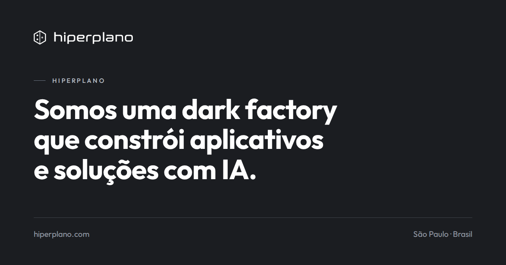

Somos uma **dark factory de software**. Agentes de IA escrevem, testam e entregam o software de
ponta a ponta. Pessoas decidem o que construir e o que vai ao ar.

## Da fábrica

| Produto | O que é | Situação |
|---|---|---|
| **[Aluy](https://aluy.dev)** | Agente de terminal: lê e edita arquivos, roda comandos e leva a tarefa até o fim | no ar, beta público |
| **[Concordância](https://www.concordancia.com.br)** | Estudo bíblico com concordância, comentários e análise textual | no ar |
| **Ajuntei** | Finanças pessoais: quanto você juntou, cofrinhos e a casa compartilhada | em construção |
| **Fluider** | Plataforma de trading quantitativo | em construção |
| **Holdly** | Para quem faz investimento em valor | em construção |

## Código aberto

- [`aluy-cli`](https://github.com/hiperplano/aluy-cli): o agente de terminal, com o seu provider de LLM.
- [`aluy-cli-site`](https://github.com/hiperplano/aluy-cli-site): instalação e documentação do CLI.
- [`aluy-mcp-rpa`](https://github.com/hiperplano/aluy-mcp-rpa): MCP de automação visual de desktop.

[hiperplano.com](https://hiperplano.com) · [English](https://hiperplano.com/en/) · São Paulo, Brasil
